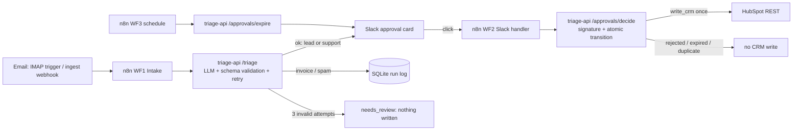

# TriageGate - AI email triage your CRM can trust

> **Demo project. All data is synthetic.** n8n + Python (FastAPI) + Slack + HubSpot.
> The point is not "an LLM classifies emails" - it is the reliability engineering around the LLM:
> schema-validated output, retries, quarantine, a human click before any CRM write, idempotent
> approvals, expiry and a full audit log.

## Problem

A shared inbox mixes leads, support requests, invoices and spam. Naive "AI automation" writes
hallucinated, malformed or duplicate records straight into the CRM and nobody can say why.

## Approach

1. An email arrives (read-only IMAP trigger, or the ingest webhook used by the eval).
2. `triage-api` (FastAPI) asks Claude to classify it and extract company / contact / summary / urgency.
   Output is validated against a strict Pydantic schema (`extra=forbid`, enums, length limits). Invalid
   output is retried (max 3 attempts, the validation error is fed back). Still invalid -> `needs_review`:
   **no Slack card, no approval, no CRM**.
3. Sales leads and support requests become a Slack card with Approve / Reject. Invoices and spam are only logged.
4. The Slack click reaches n8n (Socket Mode: a small `slack-socket` listener forwards it over the compose
   network, no public URL; HTTP mode: Slack POSTs it, signed). n8n hands the body to `triage-api`, which verifies
   the Slack signature (HTTP) or the internal forward secret (Socket Mode), then flips the approval `pending -> approved` with one atomic SQL
   `UPDATE ... WHERE status='pending' AND expires_at > now`. Only the single winner gets a CRM payload;
   a second click is logged as a duplicate.
5. n8n writes to HubSpot (search contact by email, create/update contact, then company or ticket with
   associations) and reports the result back; the Slack card is updated.
6. A schedule expires stale approvals (24 h in production, 2 min in the demo). Clicking an expired card does nothing.

## Architecture



| Component | Tech | Role |
|---|---|---|
| Orchestrator | n8n 1.64.0 (Docker) | triggers, Slack and HubSpot HTTP calls, 3 workflows in `n8n/workflows/` |
| triage-api | FastAPI, Pydantic v2, SQLite | LLM call, validation/retry, approval state machine, Slack signature, audit log |
| LLM | `claude-haiku-5-5` via the Anthropic SDK, prompt caching, `max_tokens=700` | classify + extract |
| Human approval | Slack Block Kit (bot scope `chat:write` only) | Approve / Reject |
| Click delivery | `slack-socket` (slack_sdk Socket Mode, `SLACK_APP_TOKEN` app-level token) | acks in <3 s, forwards to n8n `slack-actions`; no tunnel |
| CRM | HubSpot REST with a service key (Bearer) | contacts, companies, tickets |

No credential lives in the workflow JSON: Slack and HubSpot are called with Bearer tokens read from the n8n
container environment, so the workflows import and run with zero credential setup in the n8n UI.

## Results (real run, 2026-10-17, model `claude-haiku-5-5`, 40 synthetic emails through the full n8n path)

Source files: `eval/results/summary.json`, `confusion_matrix.md`, `fault_*.json`, `expiry_demo.json`.

| Metric | Result |
|---|---|
| Classification accuracy | **40/40 (100%)**; precision, recall, F1 = 1.00 for all four classes |
| First-attempt schema validity | 40/40, 0 retries, 0 needs_review (natural run) |
| Extraction (lead + support emails, n=28) | contact email 28/28, company 27/28 ("Larkfield IT" vs "Larkfield"), urgency 21/28 (75%) |
| Forced invalid output: first attempt poisoned | 5/5 caught, retried, recovered; 0 approvals from invalid output |
| Forced invalid output: every attempt poisoned | 3/3 quarantined as `needs_review`; 0 Slack cards, 0 approvals, 0 CRM writes |
| Invalid outputs that reached the CRM | **0 of 8** |
| Double approve (5 trials: 4 sequential double clicks + 1 simultaneous pair) | 5/5 produced exactly **1** CRM write; 5 duplicate clicks ignored; **0 duplicates** |
| Reject (3) | 3 rejected, 0 CRM writes |
| Bad Slack signature (1) | refused and logged; approval stayed `pending` |
| Expiry (3, TTL 2 min) | all 3 expired by the schedule within 179 s, cards updated, a later Approve click -> `expired`, 0 CRM writes |
| Latency, triage-api (LLM + validation) | p50 1.42 s, p95 1.60 s |
| Latency, end to end via n8n (incl. Slack post) | p50 2.58 s, p95 4.26 s |

Honest notes on these numbers:

- 100% on 40 hand-written synthetic emails is a regression check, not a claim about your inbox. The first
  eval run exposed a real bug in my own business rule (a sender like `no-reply-user@...` was refused as a
  contact, quarantining one support email); it is fixed and covered by a unit test. The table is the re-run.
- **Real HubSpot proof (2026-10-18, real portal, no mock, `HUBSPOT_API_BASE` unset).** The first key was
  read-only (creates returned 403: the designed `crm_failed` path, `eval/results/real_hubspot_check.json`).
  After `crm.objects.{contacts,companies,tickets}.write` were added, signed simulated clicks through the full
  n8n path gave: 4 single approvals + 5 double-approve trials (4 sequential, 1 simultaneous pair) -> 14 approved
  approvals (incl. 5 from a first partial run) -> **14 CRM write rows, exactly one per approval, 0 duplicates**;
  14 contacts, 9 companies, 4 tickets in the portal, all marked `[TriageGate test]` (ids in
  `docs/test-records.md`); 3 rejects -> 0 records; 3 expired approvals (TTL 2 min, expired in 131 s) -> a later
  Approve changed nothing, 0 records. Files: `eval/results/real_hubspot_run_summary.json`,
  `real_hubspot_expiry.json`. The earlier mock-based counts (table above) are kept as the original measurement.
  The partial first run (`real-1`) crashed after its single/double clicks because its 14-email slice
  contained only sales leads, so the final run used a hand-picked 12-email slice (6 leads, 6 support).
- The eval's Slack clicks were simulated with correctly signed payloads sent to the same n8n webhook Slack would call
  (also verified through a cloudflared quick tunnel). Real clicks now arrive through Socket Mode (see Slack setup).

## Cost per run

| | |
|---|---|
| Per email | **$0.000123** (172.8 uncached input + 2,888 cached input + 153 output tokens at $0.10 / $0.50 per MTok) |
| 40-email eval | $0.0049 |
| Whole build incl. reruns, fault and expiry runs | well under US$0.02 |
| Infrastructure | $0 (local Docker, Slack Socket Mode, free Slack) |

## How to run

Prereqs: Docker Desktop, Python 3.11. No tunnel is needed (cloudflared only for the optional HTTP mode).

```bash
python -m venv .venv && .venv/Scripts/pip install -e "triage_api[dev]" httpx python-dotenv
cp .env.example .env                       # fill in values (never commit .env)
docker compose up -d --build               # n8n :5678 + triage-api :8000 + slack-socket
bash scripts/reload_workflows.sh           # import + activate the 3 workflows
python eval/run_eval.py --mode n8n --n8n-url http://localhost:5678/webhook/triage-ingest --run-tag demo --simulate-clicks
python eval/recompute_metrics.py           # recompute metrics from the saved export (no LLM)
.venv/Scripts/python -m pytest triage_api/tests eval/tests
```

- Check the listener: `docker compose logs slack-socket` should show `connected to Slack Socket Mode`.
- Tests: `.venv/Scripts/python -m pytest triage_api/tests eval/tests` and `cd slack_socket && ../.venv/Scripts/python -m pytest tests`.
- No Slack click possible? `python scripts/simulate_click.py <approval_id> approve` sends a signed payload.
- Local HubSpot stand-in: `HUBSPOT_API_BASE=http://hubspot-mock:8010 docker compose --profile mock up -d --build`.
- Reliability proofs: restart triage-api with `LLM_FAULT_INJECTION=first_attempt_invalid|always_invalid` or
  `APPROVAL_TTL_MINUTES=2`, then `python eval/run_reliability.py fault|expiry`.
- Check the workflows import into a fresh container: `powershell scripts/verify_import.ps1` (exit 0 = clean).

## Slack setup (Socket Mode, default, no tunnel)

1. Create the app from `docs/slack_app_manifest.yml` (Socket Mode and Interactivity on, no Request URL).
   Install it to the workspace, copy the Bot token (`xoxb` prefix) and Signing Secret, invite the bot to the channel.
2. Get the app token: app settings -> Basic Information -> App-Level Tokens -> Generate Token and Scopes ->
   scope `connections:write` -> copy the app-level token (starts with `xapp`).
3. Put `SLACK_APP_TOKEN` in `.env` (`SLACK_MODE=socket` is the default). `python scripts/add_socket_env.py`
   copies it from a private secrets file and generates `INTERNAL_FORWARD_SECRET` (shared by the listener and
   triage-api; Slack does not sign Socket Mode payloads, so this header authenticates the internal hop).
4. `docker compose up -d --build`, then `bash scripts/reload_workflows.sh` (WF2 reads the forward-secret header).

Click path: Slack -> websocket -> `slack-socket` (ack) -> n8n `slack-actions` -> `triage-api /approvals/decide`
(same atomic idempotency, expiry, reject and card update as before). The forward secret is only honoured when
`SLACK_MODE=socket`; the signed-HTTP check is unchanged.

**Alternative, HTTP mode (needs a public URL):** set `SLACK_MODE=http`, turn Socket Mode off in the app, run
`cloudflared tunnel --url http://localhost:5678` and set the Interactivity Request URL to
`https://<tunnel>/webhook/slack-actions`. Slack's signature is then verified; the listener idles.

## Limitations

- Local only. SQLite, single node. (HTTP mode needs a tunnel whose URL changes every session; Socket Mode does not.)
- Text emails only (no attachments / OCR), English-centric prompt, no auto-reply by design.
- 40-email synthetic set; urgency is the weakest field (75%) because urgency is subjective.
- Real HubSpot writes were verified on 2026-10-18 against a test portal (see Results); the test records are still there (`docs/test-records.md`).
- The IMAP trigger is exported disabled and was not run against a mailbox in this build.
- Prompts stay far below 100K tokens (cheap pricing tier); email bodies are truncated to 8,000 characters.

## Layout

```
slack_socket/          Socket Mode listener + Dockerfile + tests
n8n/workflows/        3 exported workflows (generated by scripts/build_n8n_workflows.py, import-verified)
triage_api/           FastAPI service + pytest suite
eval/                 dataset (40), runner, metrics, reliability harness, results/
tools/hubspot_mock/   local HubSpot stand-in (demo only)
docs/                 architecture, Slack manifest, HubSpot setup, test records, video script, Upwork entry
site/                 product pages
```

Tests: 81 passing (`pytest triage_api/tests eval/tests`) plus 4 for the listener, `ruff check` clean. License: MIT. Built as a portfolio demo.
